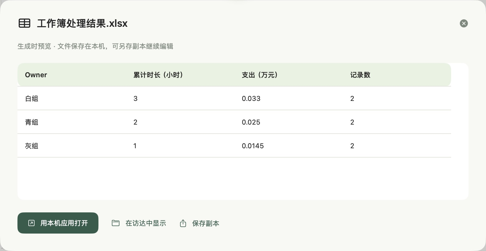

# 归屿 Guiyu

归屿是一款面向非技术华语使用者的本地AI助手。用中文交代目标，在授权工作区内查资料、处理工作簿、核对数字与日期，最后预览和导出表格、文稿或脱敏副本。

当前提交演示版本为 **0.27.1**，以 **Apple Silicon 32GB** 为基础，默认 **Qwen3.6 35B A3B MLX 4bit**。BGE中文检索、AstrLink Guard与OpenAI Privacy Filter是独立功能组件。实测设备是M5 32GB，macOS27.2；当前不把旧16GB方案作为该版本支持承诺。

## 打开演示

1. 自行退出旧版归屿，双击 **打开归屿.command**。启动入口检查已有实例，避免重复加载模型。新设备先运行 **准备归屿.command**；准备阶段联网获取固定组件，处理资料时全程本地。
2. 首页点击 **打开归屿演示工作区**。四份虚构资料提供工作簿汇总、最新活动安排和脱敏分享目标。
3. 选择目标后按 **Return发送**，**Shift+Return换行**。中文输入法选词不会发送。工具由Agent安排，修改原文件仍须预览与独立确认。
4. 表格任务完成后可以追问“只要第一名，其他口径、排序和列不变，不用Word”。成果可预览，并导出XLSX、CSV、Word等常见格式。

[下载演示版本](https://github.com/Huazhao-nine/guiyu/releases/tag/v0.27.1) · [使用与复现说明](docs/SUBMISSION_DEMO_V0_27_1.md) · [当前界面实际成果](qa/v0.27.1/outputs/) · [此前后端成果页面](qa/v0.27/examples/index.html)



## 本地资料与隐私

对话、资料读取、索引、工具和隐私识别全部在本机完成，没有云端推理回退。模型下载由独立组件处理，不接收任务资料、对话或历史。用户选择授权工作区，保留来源与中间结果；原文件变更先生成预览，再取得独立确认。

直接说“把这份资料整理成可分享版本”，归屿会检索、完整读取可处理正文，调用本地隐私组件与规则，复查后生成TXT、Markdown和Word副本。保留分类选择、脱敏预览与规则补充，办公金额和日期默认保留。所选组件缺失或检查失败时停止，不交付冒充已检查的副本。扫描图片、附件和所有隐藏内容尚不属于完整覆盖承诺。

## 本轮改进与证据

仅更改导出格式时，重放来源证明并保留已核对结果的列、条件、排序和数值，减少无必要的重新规划。

保留未过滤文字资料的版本与沿用关系，使检索、计算、日历和写作共享已核对事实；规划提示不能授权新数字，错误反馈不能改写原目标。同类型待执行步骤接收反馈，减少重复。新增自然日、日期与星期对应、未经来源支持的退款时间检查，改进文稿自动修订与Word呈现。

此前0.27后端五项交付首次3/5，修订与逐页交付复核分别记录。日期评分器曾把正确的中文日期格式判为缺失，原报告和同一输出的格式纠正均保留；随后实际文稿审阅又发现错误星期和新加退还条件，另行记录并修正。最终成绩、源哈希和七项已知回归见 [本轮评估](qa/v0.27/evaluation.json)。这些是开发者组织的有限虚构案例，不是任意新资料成功率或独立用户研究。

741项Python检查通过，原生代码检查覆盖范围与历史、自动执行、隐私组件串行取消、Return与中文输入法。模型任务禁网，原文件哈希保留。Word逐页渲染与内容检查见 [交付文件验证](qa/v0.27.1/word-validation.json)，当前版本的打包与干净源码重建收据由Release的validation JSON提供。

0.27.1进一步保留日期步骤、分离工具目标，重复成功的计算或日期调用会转入独立交付核对。文稿复核使用实际草稿引用和受限结构，修改意见先对照原要求与已写内容核验；实际工具的计算、子表达式和日历结果重新执行，防止正确结果被复核误报反复改坏。源文未提供的付款时间与退还条件仍会阻止交付。

真实原生交互使用独立验收应用与虚构资料。0.27发布源码的六个已知目标首次5/6，综合任务失败；0.27.1中间失败、源哈希与最终复测分别保留在 [原生验收](qa/v0.27.1/native-evaluation.json)。最终同组六项原生修复复测6/6；这不代表任意新资料成功率。程序检查、模型运行、真实界面和实际Word渲染分别记录，详见 [当前版本证据](docs/SUBMISSION_DEMO_V0_27_1.md)。应用以macOS14为编译目标，实测macOS27.2，使用临时签名，尚未做Apple公证。

## 构建与验证

```sh
zsh scripts/build_model_demo_v27_1.sh
python -m unittest discover -s tests -q
zsh scripts/check_native.sh
python scripts/check_delivery_reuse_v27.py  # CPU回放，文稿事实选择使用桩
```

Python需安装requirements.lock对应依赖。真实模型复现用GuiyuRuntime的Python运行 `scripts/check_submission_patch_v27_1.py --label reproduction`，会创建新的独立虚构工作区并使用禁网沙箱。期望值不传入模型。模型测试须串行；模型权重、Python环境、正常工作记录和私有原始轨迹不随分发包提供。

## 开放与申请

自有核心代码使用 [Apache-2.0许可](LICENSE)，上游模型与组件保留各自许可。源码、虚构任务、检查方法和失败记录供其他社区复用与独立维护。

GCC申请材料包括逐字段填写稿、四页申请说明、八页路演、预算、演示讲稿和实际成果。申请8,000 U、十二周，只支持未来公开复现、普通华语使用者验证和范围限定外部复核。计划每周20小时，资助后继续维护至少六个月。申请尚未在网页提交。
