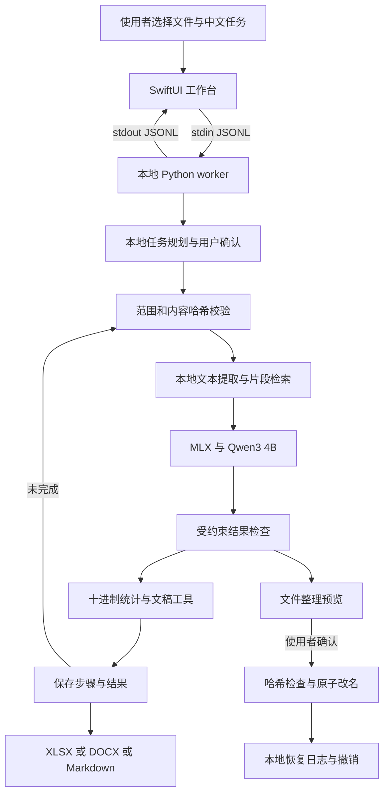

# 归屿 MVP 与技术方案

归屿让没有技术背景的华语使用者在自有电脑上处理私人资料。v0.3 聚焦资料与日常办公：查找、提取、统计、写作与整理，通过内置虚构样例、中文任务计划和结果预览降低首次使用门槛。当前为简体中文 macOS 应用，繁体中文与更多设备兼容性属于后续里程碑。

## MVP 验收

| 场景 | 当前行为 | 后续验收 |
| --- | --- | --- |
| 一句话完成多步办公 | 先查看最多六步的计划，逐步调用本地工具，保存完成结果，停止后继续 | 扩充中文意图、依赖关系与异常恢复任务集 |
| 表格统计与文稿 | 从三笔费用得到 431.70 元合计与 143.90 元平均值，生成两份 XLSX、DOCX 与 Markdown | 比较真实办公任务的字段准确性、完整性与修改成本 |
| 三份活动材料提取表格 | 真实本地模型生成两条记录，导出 XLSX | 扩展 30 组虚构中文资料，字段准确率和出处分别评估 |
| 根据材料生成汇总 | 实时呈现、出处编号、DOCX 导出 | 人工核对重要事实和遗漏，不能仅凭存在引用判断正确 |
| 分类与重命名 | 逐文件预览，确认执行，检查冲突和内容变动，支持撤销 | 异常中断与跨版本恢复验证，审阅恢复日志 |
| 普通用户首次使用 | 中文引导与样例，不需要 API Key | 非技术用户独立完成率、首个结果耗时、隐私理解 |
| 本地隐私 | 主进程和工具进程禁止网络，处理前探测，管道通信 | 支持的 App Sandbox/XPC 架构及独立复测 |

## 数据流

主进程启动即安装 deny network 策略，子进程继承。模型准备脚本单独运行，不接收任务文件。当前没有后台 Web 服务。八种工具由程序注册，常见办公意图先按规则生成计划，未识别时才使用本地模型选择工具。模型不获 shell、联网或任意工具调用权限，整理计划只能使用已选资料的来源 ID 和单级类别。

## 技术取舍

原生 SwiftUI 提供文件选择、拖放、键盘操作、系统字体与轻量界面。MLX 复用 Apple 芯片的统一内存和 Metal。默认 Qwen3-4B-Instruct-2507 4-bit 减少下载和内存压力，模型提交与文件哈希固定于 `packaging/model-manifest.json`，不会悄悄切换在线服务。v0.3 可在本地模型库添加和切换兼容 MLX 模型，切换后重建 worker 并验证隔离；不同模型需分别评估速度和中文质量。

检索为透明的本地文本分段与关键词排序，不建立持久向量数据库。查找返回匹配文件，组合任务后续只使用匹配资料。资料超出上下文时选择部分片段并显示提示。工作记录保留结果、资料名称路径和预览，计划记录保存执行状态。普通任务传递近期六轮对话；存在行筛选时，生成只使用当前匹配行与本轮结果。原始表格、条件、分组与对话父子关系在本机保存，不能声称具有无限长期记忆。

安全优先采用范围小且可复核的能力。新量化算法、训练、多机集群、OCR 和通用电脑控制不纳入本版。申请中的公共价值来自中文任务体验、可复用本地工具、可暂停的办公流程及可验证隐私流程，模型推理库与基础模型贡献归原作者。查询、追问与模型管理见 [v0.3 说明](QUERY_AGENT_V0_3.md)，原工作流协议见 [v0.2 说明](OFFICE_AGENT_V0_2.md)。
